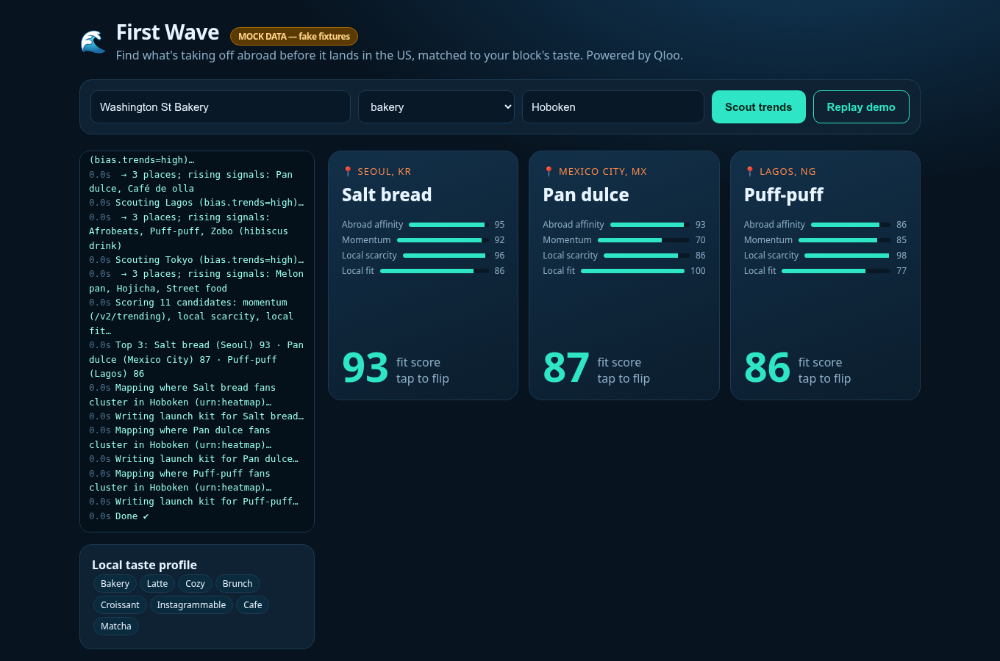

# 🌊 First Wave

**Catch the next trend before it lands.** First Wave is an AI agent that scouts what's taking off in Seoul, Mexico City, Lagos and Tokyo, finds the trends that *haven't* reached a US neighborhood yet, scores how well each fits that block's taste, and hands a small business a ready-to-launch kit that credits the origin culture.



Built for the [Qloo Agentic Hackathon](https://qloo.devpost.com/).

## What makes it Qloo-powered
Without Qloo there's no cross-city taste data and no local gap, so the app can't work. Every number on a trend card comes from Qloo:

| Step | Qloo call |
|---|---|
| Resolve business type to a tag | `GET /v2/tags?filter.query=bakery` |
| Local taste profile | `GET /v2/insights?filter.type=urn:entity:place&filter.location.query=Hoboken&filter.tags=<type tag>` |
| Scout abroad | `GET /v2/insights?filter.type=urn:entity:place&filter.location.query=Seoul&filter.tags=<type tag>&bias.trends=high` |
| Momentum | `GET /v2/trending?signal.interests.entities=…&filter.type=…&filter.start_date=…&filter.end_date=…` |
| Local scarcity | `GET /v2/insights?…&filter.location.query=Hoboken&filter.tags=<trend tag>` (fewer results = more whitespace) |
| Where to promote | `GET /v2/insights?filter.type=urn:heatmap&filter.location.query=Hoboken&signal.interests.tags=<trend tag>` |

**Fit score** = weighted geometric mean of *abroad affinity × momentum × local scarcity × local fit* (`lib/score.ts`). A trend that's already saturated locally can't score high.

The LLM only writes the launch-kit copy (product name, price, event, caption, diaspora outreach, credit note) from the Qloo evidence. With no LLM key, a deterministic template is used instead.

## Run locally
```bash
npm install
cp .env.example .env.local   # add QLOO_API_KEY (optional LLM_API_KEY)
npm run dev                  # http://localhost:3000
npm test                     # gap-score unit tests
npm run build
```
With no `QLOO_API_KEY` (or `QLOO_MOCK=1`) the app runs on **clearly labeled fake fixtures** (`lib/fixtures.ts`, every name prefixed `[MOCK]`, and a "MOCK DATA" badge in the UI). Those fixtures aren't Qloo data.

**Replay demo** re-streams the last live run from a private in-memory server cache. That's useful on stage if the network is slow.

## Deploy (Vercel)
1. `npx vercel` (or import the GitHub repo at vercel.com/new) and pick Next.js.
2. Set env vars: `QLOO_API_KEY`, `QLOO_BASE_URL=https://hackathon.api.qloo.com`, optionally `LLM_API_KEY`, `LLM_BASE_URL`, `LLM_MODEL`.
3. Deploy. Keys stay server-side (`lib/qloo.ts` is `server-only`).

## Data policy
Qloo responses are cached **privately in server memory only**. Per Qloo's hackathon guide, Qloo data must never be committed to this public repo.

## Structure
- `lib/qloo.ts`: the single Qloo client (+ mock mode)
- `lib/agent.ts`: the scout loop
- `lib/score.ts`: the gap score
- `lib/llm.ts`: the launch kit (LLM or template)
- `app/api/scout`: the streaming NDJSON endpoint
- `app/page.tsx`: the UI
- `app/kit`: the launch-kit page

## Respect
First Wave is about cultural trend *scouting with credit*. Every kit names the origin culture, uses the original name, and recommends partnering with (and paying) local diaspora makers.

MIT © 2026 Derek Soltis
